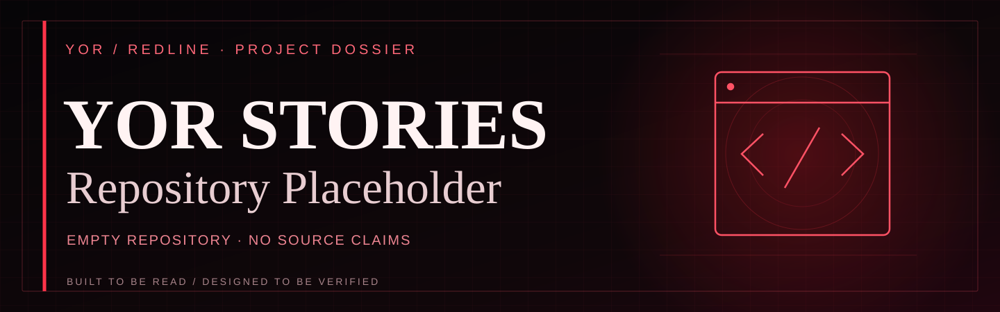
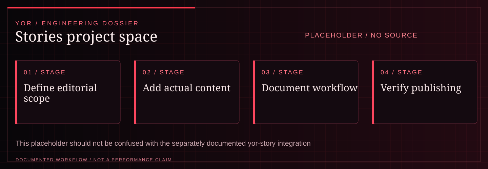

<!-- YOR REDLINE / README COVER V1 -->

<picture><source media="(max-width: 600px)" srcset="docs/yor-redline-cover-mobile.svg"/></picture>

<strong>YOR / PROJECT DOSSIER</strong> · <a href="https://github.com/yorayriniwnl">GitHub</a> · <a href="https://yorayriniwnl.in">Portfolio</a>

<!-- END YOR REDLINE -->

# YOR STORIES // Repository Placeholder

> **Repository status: empty at the time of this README's creation.** No source code, executable application, deployment, or test results are claimed here.

<!-- YOR REDLINE / EXPERIENCE V2 -->

## System map

<picture><source media="(max-width: 600px)" srcset="docs/yor-redline-system-mobile.svg"/></picture>

| Project signal | Documented scope |
| :--- | :--- |
| **Current maturity** | PLACEHOLDER / NO SOURCE |
| **Technical focus** | A repository initialized with a README for future stories-related source or documentation. |
| **Evidence boundary** | This placeholder should not be confused with the separately documented yor-story integration project. |

**Navigate:** [About](#about) · [Current evidence](#current-evidence)

<!-- END YOR REDLINE / EXPERIENCE V2 -->

## About

This is a placeholder for future project documentation. Add a sourced project summary, repository structure, verified setup steps, and current limitations when implementation begins.

## Current evidence

| Area | State |
| --- | --- |
| Source files | Not available yet |
| Setup and tests | Not documented |
| Deployment | Not claimed |
